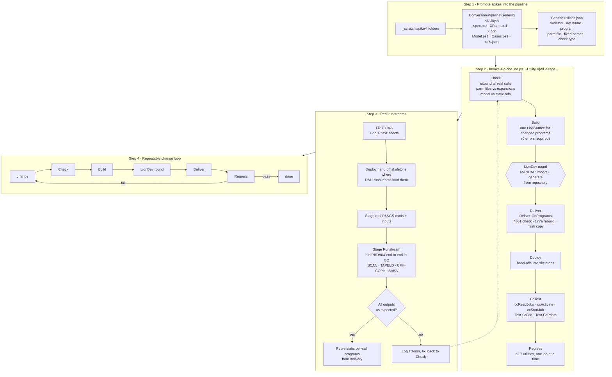

# MT-043: generic programs into the pipeline, then real runstreams (proposed 2026-10-21, not started)

Order: Step 1 and 2 first (removes most manual reading), then Step 3 starting with PBDA04.
Nothing is committed; commit only on the owner's go-ahead.

## Decisions 2026-10-21 (owner)

- **Step 1 is done cluster by cluster, each reviewed** (`Generic\Test-Promotion.ps1`: parse, no `_scratch` refs, offline check, the
  Prepare scripts rewrite byte-identical CC jobs and includes). Cluster 1 LOADIS done; next CHABAN, CFH-COPY, BABA, FUSBA, SCAN group.
  Code goes to `Conversion\Pipeline\Generic\<UTILITY>\{gen,check,cc}`, run artefacts to `E:\Repos\ssg4-work\generic\<UTILITY>`,
  one-off probes stay in `_scratch`.
- **Release target is FEDERALE_APP.** Once an RC is packaged and released, the runbook becomes the Federale-app runbook: the generic
  programs and hand-off skeletons run under the client's application, not our trial application `AFBUS_2200COBOL_AMT`. So nothing
  may hard-code the application: name, base path (`APPROOT\Binaries\Programs`), settings `AppName` and the scripts folder come from
  one environment file with profiles.
- **Environment profiles** (Step 1, `Generic\environments.psd1`): `Mock` (mock system + mock file controller), `CC-Trial`
  (`AFBUS_2200COBOL_AMT`, APPID 6, `E:\Repos\AMT\Apps\AFBUS_2200COBOL_AMT\Binaries`), `CC-Federale` (`FEDERALE_APP`,
  `E:\Repos\Federale_InternalRelease\AFBUS_AMT\Binaries`). Every script takes `-Environment`.
- **Release package** (Step 2 stage `Package`, `New-GnReleasePackage.ps1`): deliverables only (generic DLLs, hand-off skeletons and
  includes, settings notes, manifest with SHA256, install steps); the `check\`/`cc\` test kit stays out. Copying an RC = copying that folder.
- **Runbook tab 2 is rewritten after Step 2, split in two:** (a) *Mock-harness test runtime configuration* (mock system, mock file
  controller, offline checks, model vs static references) and (b) *AMT CC runtime* (deliver, deploy hand-offs, register and activate
  jobs, run, verify, package). The static per-call route stays as a short "superseded" note.
- **Two kinds of settings, kept apart** (MT-044): *pipeline* paths in `Generic\environments.psd1` (named after AMT's base-path
  fields: SYSROOT, AppBasepath/APPROOT, ExtractPath, ScriptPath, PrintPath, LogPath) and *run-time* settings for the deliverables:
  the `Xqt` → generic program map as AMT `CloneReports` entries in the script set's `AmtSettings.xml`, plus our own
  `SsgUtilities.json` beside the includes only if something else is needed. Not `Sys.ini`. Set up now, cleared with R&D later.
  The hand-off change (read the map instead of setting it) touches the shared `GnHandoff.inc`, so it lands with a full CC
  regression of all utilities at the end of Step 1.
- **End-of-Step-1 checklist** (owner 2026-10-21: if one is missed, the full CC proof run catches it). DONE 2026-10-21: the shared scripts
  (`Deploy-GnSkeleton`, `Deliver-GnPrograms`, `Test-CcJob`, `Test-CcPrints`, `Test-Promotion`) take `-Environment` and hold no absolute
  paths; the 17 converted skeletons are in `Generic\skeletons` (hash-identical to `_scratch\ecl-cmp3\out`); `Generic\utilities.json`
  (checked by `Test-GnUtilities.ps1`); re-running every utility's Prepare script left all 39 deployed skeleton/include/job/settings files
  byte-identical. MT-044 DONE: the hand-off checks the `CloneReports` entries (`Deploy-GnScriptSet` writes them from `utilities.json`), and the full CC regression passed (jobs 838-919, all byte-identical; see tracker MT-044). STILL OPEN: (a) the R&D question on `CloneReports` and the FEDERALE_APP skeleton location;
  (b) DONE: the promoted `_scratch\spike-*` folders were archived, not deleted (owner: the process will be reused for other reports): `E:\Repos\ssg4-work\archive\spikes-20261021.zip` + `.MANIFEST.csv` (781 files, SHA256, read-back verified); references in the docs now point to `Generic\<UTILITY>` or to the zip; (c) SCANGROUP `Build-ScanGroup` builds
  SCAN-RB/CONDIS2 refs from the pre-landing `allcalls\expanded-fix` (SCAN-RB patches the dropped IF back in by hand): re-base on
  `expanded-landed2` and drop the patch in the next LionDev round; (d) the CONDIS2-GN source comment now says `Generic\CONDIS2\spec.md`
  (comment only), so the next LionSource differs by that line; (e) `CfhCopyParm` still defaults `-Program` to the dead `..._CFH_COPY_G`
  (the skeleton call passes `..._GN` explicitly): change the default when the include is next redeployed under a CC run.

## Step 2 progress (`Generic\Invoke-GnPipeline.ps1 -Stage <S> [-Utility X,Y|All] [-Environment E]`, built one stage at a time)

- **Check** DONE 2026-10-21: `utilities.json` vs the repo, then each utility's parameter/offline check; cross-check counts must equal the
  baseline in `utilities.json` (`check.crosscheck`; known differences are listed there). All 8 pass; a wrong baseline fails with exit code 1.
- **Deploy** DONE 2026-10-21: `Deploy-GnScriptSet` + each skeleton with its hand-off and include from `utilities.json`; verifies parse,
  include hashes, `GnHandoff.inc` and the `CloneReports` entries. All pass; re-running changes none of the 23 deployed files.
- **Build** DONE 2026-10-21: the 7 generic COBOL sources -> ONE LionSource (`<GenericWork>\build\GNBUILD\out`), pre-checks (PROGRAM-ID, T3-040 input 4001), 0 errors required, reports which sources changed and how the LionSource differs from the previous build (tested: unchanged, changed comment, broken input FD). LATER (with Deliver): compare against the last IMPORTED LionSource, which Deliver records.
- **Deliver** built 2026-10-21, pre-checks tested only (`-CheckOnly`: default Since = the build LionSource time -> 7 FAIL "not regenerated", old/future -Since behave); the rebuild + copy + `imported.LionSource` path needs the next LionDev round. Build now compares against `imported.LionSource` and keeps the LionSource time when identical.
- **Owner rule (2026-10-21): a LionDev round is 1-2 imports, never one per group.** Build now makes TWO LionSources: `GNBUILD` (7 GN programs) and `GNREF` (test-only references from utilities.json `references`, built by the group builder with `-RefsOnly`; SCAN group = CONDIS2-RV/RD, SCAN-RA/RB, TAPELD-RA/RB; SCAN-RB now from the landed T3-045 expansion, no manual IF patch). Deliver takes both sets (references skip the T3-040 input check) and records `imported.LionSource` per set. A new group with its own references = one more entry in `references`.
- **Regression on the LionDev-round DLLs DONE 2026-10-21 23:36-23:45, all byte-identical / as expected:** CFH-COPY 5/5 (jobs 920, 922, 924, 926, 928), BABA 11/11 (930), CHABAN 8/8 (938), FUSBA 12/12 (947), CONDIS2 6/6 (957), SCAN group prints 8/8 (964), LOADIS vs static 2/2 layouts (977), LOADIS/UNLOADIS all 15/15 (984), aborts UNSORTED/DUPLICATE (1000/1001). The pipeline's CcTest/Regress stage still has to wrap this sequence (prepare, start, check per utility; `ccStartJob` needs the signed-in CC page).
- **Regress stage built and proven 2026-10-21 23:50-23:57:** `-Stage Regress` prepares the selected utilities, lists the 14 jobs of utilities.json `regress` with their last result (`<GenericWork>\regress-results.csv`) and whether it is newer than the last delivery (exit code = jobs without a current PASS); `-Job <name> [-JobParam P] -StartLine '<ccStartJob line>'` waits for one job, scans its log, byte-compares outputs / prints / extra checks and records it. Re-ran all 14 jobs through it: all PASS (the DUPLICATE abort of the first regression had been started but not checked; it is checked now). The LOADIS check scripts now exit non-zero on failure; Prepare-GnRun writes the per-case CFH files.
- **Package stage built and tested 2026-10-22:** `-Stage Package` (all utilities, `-Target` default CC-Federale) does not gate on regression or LionSource state (owner: it is for R&D; a newer LionSource can be valid): the last regression result of each job and the imported LionSource hash go into RELEASE-NOTES.txt; it fails only when a file to copy is missing. It stages `<PackageRoot>\GN-<time>` (7 DLLs, application DLLs, 13 skeletons + 9 includes from the proven deployed set, CloneReports.xml, RELEASE-NOTES.txt, INSTALL.txt with CONFIRM items for R&D, manifest.csv SHA256). Nothing is installed. Per-utility packages work (`-Utility X`; LOADIS gets the CFH-COPY program it runs on; folder GN-<time>-<utility>): tested all 37 files, LOADIS 15 files, BABA 12 files. 
- Still to build: **CcTest** (stage + start + check; the start is the
  Control Center, which needs your sign-in), **Regress** (all utilities, one job at a time), **Package** (release folder), then the runbook tab 2 rewrite.