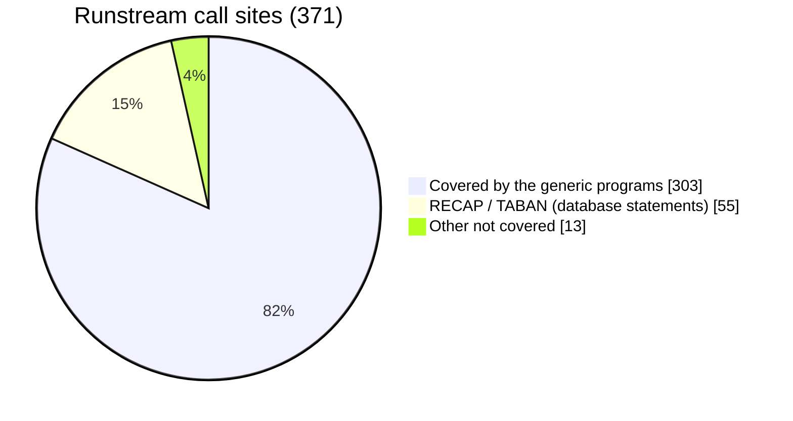
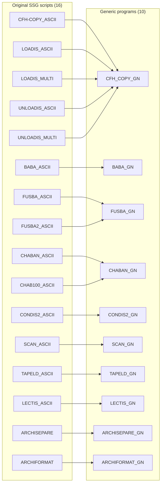
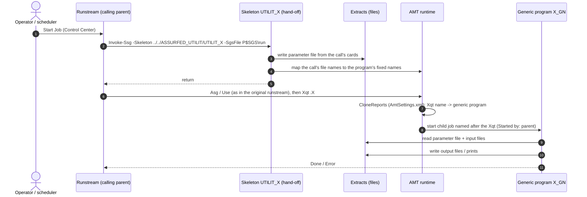
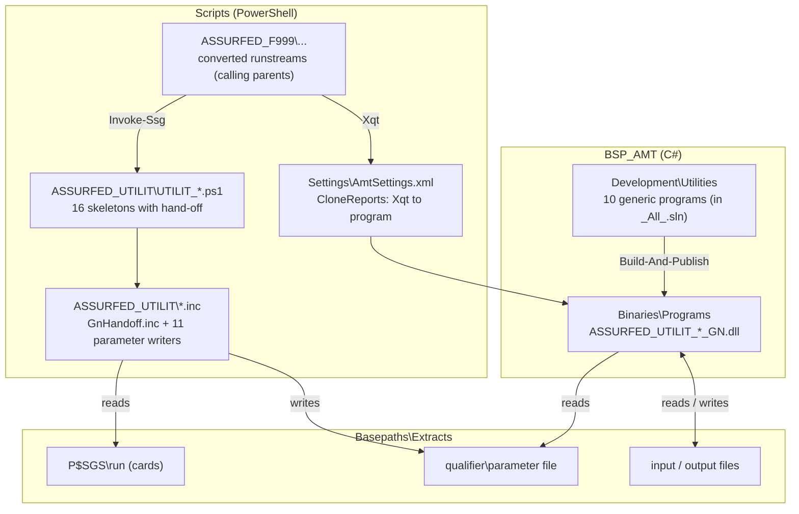
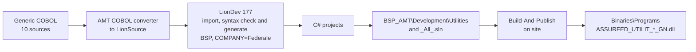

# SSG Utilities — Generic Programs
## Program Summary (high-level specification)

<!-- Sections marked GEN are refreshed for each release by the release tooling; edit the text outside them. -->

<!-- GEN:release -->
| | |
|---|---|
| **Release** | `release20261110-rc.03` |
| **Application** | BSP (`BSP_AMT`, namespace `Federale.BSP.BusinessLogic`) |
| **Audience** | Developers, testers, Federale |
| **Call list (Appendix A) as at** | 12 October 2026 — runstream source pack of 170 runstreams |
<!-- /GEN:release -->

---

## 1. Purpose

On OS 2200, many batch runstreams called **SSG (Symbolic Stream Generator) skeletons** — small
"utility" generators such as `CFH-COPY`, `BABA` or `FUSBA`. For **each call**, SSG read the call's
parameter cards and **generated and compiled a new COBOL program**, which the runstream then ran
(`@XQT`).

For example, runstream `AFPH12` (line 427) calls CFH-COPY with these cards:

```text
@SSG,IA    *UTILIT.CFH-COPY/ASCII
SGS
ASCII
INPUT      INASC,80,10
OUTPUT     OUTASC,22,10
FIELDIN    1,15
FIELDOUT   1,15
@EOF
```

They say: read file `INASC` (80-byte records), write file `OUTASC` (22-byte records), and copy
the 15 bytes at position 1 of each input record to position 1 of the output record. On OS 2200,
SSG turned exactly these cards into a COBOL program for this one call.

After migration this would mean hundreds of generated programs (one per call). Instead, each
utility is now **one generic program, built once**, that reads the call's cards **at run time**
from a parameter file. In the example, the cards are kept unchanged in the call's SGS file
(`P$SGS\AFPH12`); at run time the hand-off turns them into the parameter file and the program
`CFH_COPY_GN` carries out the copy. Changing a call means changing its cards — nothing is rebuilt.

## 2. Scope

<!-- GEN:scope -->
| | Count |
|---|---|
| Generic programs delivered | **10** (8 with calls in the runstreams; the archive programs have none) |
| SSG scripts (skeletons) covered | **14** of the 18 called from the runstreams (plus 2 with no calling runstream) |
| Runstream call sites covered | **303** of 371 (82 %) |
| Converted runstreams that use them | **153** |


<!-- /GEN:scope -->

### 2.1 Scripts → programs



Program names are shown without their common prefix `ASSURFED_UTILIT_`
(e.g. `CFH_COPY_GN` is `ASSURFED_UTILIT_CFH_COPY_GN`).

## 3. How a utility runs — the calling parent

The generic programs are **never started on their own**. A **calling parent** — a converted
runstream (`Scripts\ASSURFED_F999\...`) — reaches the step that used the utility.



What the user sees in Control Center run history: the **Xqt name** (e.g. `CFH_COPY`, `BABA`,
`TPF$` for TAPELD), *Started by* the runstream — not the program name.

## 4. Component overview



## 5. Program specifications

All programs: COBOL written once, converted to C# by AMT (LionDev 177, application BSP), batch
`AmtCobolProgram` jobs. Variable-length input records are read with a maximum of **4001 bytes**.

| Program | Started by Xqt | Purpose (summary) | Fixed files | Parameter file (record length) |
|---|---|---|---|---|
| **CFH_COPY_GN** | `CFH_COPY`, `LOADIS`, `UNLOADIS` | Copy a file record by record: whole record, or field moves (`FIELDIN`/`FIELDOUT`) plus constants (`FIXE`), optional start record. For LOADIS the hand-off also writes the indexed file's index; UNLOADIS reads an indexed file back in key order. | `CFHIN` → `CFHOUT` | `CFHPARM` (250) |
| **BABA_GN** | `BABA` | Split one file into one or two outputs by a record key: retain (`R`), exclude (`E`) or all records, up to 8 key fields and several value sets; optional ascending-key check (`SEQERROR`, with `MULTI` routing duplicates). | `BABIN` → `BABOUT1`, `BABOUT2` | `BABPARM` (400) |
| **FUSBA_GN** | `FUSBA` | Merge two key-sorted files, an update file against a master: the result is the master copied, split, cut down or updated by the update file (FUSBA and FUSBA2 variants). | `FUSIN1`, `FUSIN2` → `FUSOUT1`, `FUSOUT2` | `FUSPARM` (80) |
| **CHABAN_GN** | `CHABAN` | Create a file from the data lines that follow the step in the runstream; each record is built from consecutive lines (CHAB100: 100-byte lines). | `CHAIN` (step data) → `CHAOUT` | `CHAPARM` (80) |
| **CONDIS2_GN** | `CONDIS2` | Copy a file field by field under conditions: groups of tests (`CASE` / `OTHERWISE`) decide which field moves and constants build each output record; optional date conversions. | `FILEIN` → `FILEOUT` | `CONPARM` (250) |
| **SCAN_GN** | `SCAN` | Print the records of a file with a running count, optionally only the first *n*; ends with the number of records read. | `SCANIN` → print | `SCANPARM` (80) |
| **TAPELD_GN** | `TPF$` | Print selected fields of each record as a 132-column listing, with page titles from the cards. | `TAPLIN` → print (`TAPEOUT`) | `TAPPARM` (250) |
| **LECTIS_GN** | `LECTIS` | List an indexed file. Sequential mode: every record that passes a simple condition (`COND`) is printed in 100-byte lines after a title. Key mode (`KEYS`): the keys come from the step's data lines; each is looked up and printed, keys not found are counted. Optional Y2K key dates. | `LECIN` (+ `LECCRD`, step data) → print | `LECPARM` (250) |
| **ARCHISEPARE_GN** | `ARCHISEPARE` | Split a table unload in two by a sorted list of keys: records whose key is in the list go to the archive file (type `4A`, with a type `9` trailer); the others go unchanged to the "not archived" file. | `ARCKEY`, `ARCUNL` → `ARCOUT`, `ARCNOUT` | `ARSPARM` (250) |
| **ARCHIFORMAT_GN** | `ARCHIFORMAT` | Write a table's archive file: header from the data-dictionary report (type 0), key (1), one record per column (2), primary-key columns (3), the data (`4A`), trailer (9). The data-dictionary and description steps run in the hand-off against SQL Server (route B). | `ARFREP`, `ARFDES`, `ARFUNL` → `ARFOUT` | `ARFPARM` (250) |

The COBOL each program was generated from is in `<Project>\Documentation\*.cob` (for reading).
The number of calls per program and the calling runstreams are listed in Appendix A.

### 5.1 Hand-off (common to all)

| Step | Behaviour |
|---|---|
| Read cards | From the call's SGS file (raw card images; quoted values and continuation lines kept as SSG did). |
| Parameter file | Written to `Extracts\<qualifier>\<PARM>`, one resolved line per item, padded to the record length. |
| File names | The call's own logical names are mapped onto the program's fixed names (so one program serves every call). |
| Record sizes | Output record size set per call (task value `RECSIZE<name>`). |
| Mapping check | Stops (Abort) if the `CloneReports` entry for the Xqt is missing or points elsewhere. |

## 6. Build and delivery



| Repository location | Content |
|---|---|
| `BSP_AMT\Development\Utilities\<Project>` | C# project per program; COBOL in `Documentation\` (reading only); `README.md` (points to `Utilities\`) |
| `BSP_AMT\Development\_All_.sln` | Solution folder *Utilities* with the 10 projects |
| `Scripts\ASSURFED_UTILIT` | 16 skeletons with the hand-off; 12 `.inc` files (11 parameter writers + `GnHandoff.inc`) |
| `Scripts\Settings\AmtSettings.xml` | `CloneReports` — 12 entries, Xqt name → program |
| `Utilities\` (top level) | `README.md`, `RELEASE-NOTES.md` (with known issues), `INSTALL.md`, this summary, `Reference\Cobol\`, `manifest.csv` |

## 7. Testing

| Test | Result |
|---|---|
| Parameter files of every real call, compared with an independent expansion of the original skeleton | CFH-COPY 41 of 47, BABA 118 of 122, FUSBA 36, CHABAN 31, CONDIS2 18, SCAN 19, TAPELD 14, LECTIS 1 (all); every difference explained (quoted card values, a call without files, calls the reference expansion could not process). LECTIS also: 33 labelled test cases, writer vs model 33 of 33. ARCHISEPARE / ARCHIFORMAT: no real call; test cases only (MATCH 9 / 4, REJECTED 1 each, as designed) |
| Control Center regression: 18 jobs covering all 10 programs, including error cases (unsorted / duplicate keys, missing / invalid LECTIS condition) | Output byte-identical to the reference / errors as expected; one LECTIS test case shows the AMT reader issue T3-059 (known issue) |
| Control Center, under the application: `CFH_COPY` started from a runstream step | Output byte-identical |
| Build: the 10 projects in the BSP solution | 0 errors |

**Testers:** start the **runstream** (calling parent), not the `*_GN` job. Check the run history
for the child job named after the Xqt, then compare its outputs with the expected files.
Appendix A lists the runstreams that call each program.

## 8. Not covered (yet)

<!-- GEN:notcovered -->
| Script | Call sites | Reason |
|---|---|---|
| RECAP | 28 | Embedded database statements; needs a different approach |
| TABAN_ASCII | 27 | Embedded database statements; needs a different approach |
| (skeleton not identified) | 11 | To analyse |
| EXTEUR | 1 | Uses a table from the old LINC repository |
| FILE_SSG | 1 | To analyse |
| ARCHIFUSION | 0 | Archive utility; no calling runstream in the source pack; not converted |
<!-- /GEN:notcovered -->

## 9. Glossary

| Term | Meaning |
|---|---|
| **SSG** | Symbolic Stream Generator — OS 2200 tool that generated source from a skeleton and cards |
| **Skeleton** | The SSG template for a utility (`UTILIT_<X>`); here a PowerShell script with the hand-off |
| **Cards** | The parameter lines of one call (`P$SGS\<run>`) |
| **Calling parent** | The converted runstream whose step calls the utility |
| **Hand-off** | Code at the top of a skeleton that turns the cards into the parameter file |
| **Generic program** | One compiled program per utility, driven by the parameter file |
| **Xqt** | The runstream statement that starts a program; mapped by `CloneReports` |

<!-- GEN:appendix -->
## Appendix A. Calls by program

**As at 12 October 2026** — taken from the runstream source pack (170 runstreams). 303 call sites in 153 runstreams. *Line* is the line of the `@SSG` statement in the original runstream; *Cards* is the number of parameter cards and their keywords.

### A.1 BABA_GN — 122 calls in 83 runstreams

| Runstream | Run-id | Line | Script | Cards |
|---|---|---:|---|---|
| ASSURFED_F999RUN_2PPJ11 | 2PPJ11 | 74 | BABA_ASCII | 4: ASCII INPUT OUTPUT KEYS |
| ASSURFED_F999RUN_2PPJ11 | 2PPJ11 | 156 | BABA_ASCII | 4: ASCII INPUT OUTPUT KEYS |
| ASSURFED_F999RUN_2PPJ11 | 2PPJ11 | 240 | BABA_ASCII | 4: ASCII INPUT OUTPUT KEYS |
| ASSURFED_F999RUN_ACPA04_D2 | ACPA04 | 472 | BABA_ASCII | 5: ASCII INPUT OUTPUT KEYS SEQERROR |
| ASSURFED_F999RUN_ACPA08_LO | ACPA08 | 274 | BABA_ASCII | 6: ASCII INPUT OUTPUT KEYS SEQERROR |
| ASSURFED_F999RUN_AFEH02 | AFEH02 | 78 | BABA_ASCII | 5: ASCII INPUT OUTPUT KEYS SEQERROR |
| ASSURFED_F999RUN_AFEH04_D1 | AFEH04 | 289 | BABA_ASCII | 5: INPUT OUTPUT KEYS SEQERROR ASCII |
| ASSURFED_F999RUN_AFEH06 | AFEH06 | 82 | BABA_ASCII | 5: ASCII INPUT OUTPUT KEYS SEQERROR |
| ASSURFED_F999RUN_AFEM01 | AFEM01 | 80 | BABA_ASCII | 5: ASCII INPUT OUTPUT KEYS SEQERROR |
| ASSURFED_F999RUN_AFPH12 | AFPH12 | 170 | BABA_ASCII | 5: ASCII INPUT OUTPUT KEYS SEQERROR |
| ASSURFED_F999RUN_AFPH12 | AFPH12 | 404 | BABA_ASCII | 5: ASCII INPUT OUTPUT KEYS SEQERROR |
| ASSURFED_F999RUN_AUPA06_D2 | AUPA06 | 734 | BABA_ASCII | 5: ASCII INPUT OUTPUT KEYS SEQERROR |
| ASSURFED_F999RUN_AUPA06_D2 | AUPA06 | 1193 | BABA_ASCII | 5: ASCII INPUT OUTPUT KEYS SEQERROR |
| ASSURFED_F999RUN_AUPA07_LO | AUPA07 | 274 | BABA_ASCII | 5: ASCII INPUT OUTPUT KEYS SEQERROR |
| ASSURFED_F999RUN_CCSA09 | CCSA09 | 154 | BABA_ASCII | 5: ASCII INPUT OUTPUT KEYS SEQERROR |
| ASSURFED_F999RUN_CCSJ05 | CCSJ05 | 326 | BABA_ASCII | 4: INPUT OUTPUT ASCII KEYS |
| ASSURFED_F999RUN_CCTA08 | CCTA08 | 93 | BABA_ASCII | 3: ASCII INPUT OUTPUT |
| ASSURFED_F999RUN_CCTA08 | CCTA08 | 122 | BABA_ASCII | 3: ASCII INPUT OUTPUT |
| ASSURFED_F999RUN_CCTA08 | CCTA08 | 361 | BABA_ASCII | 3: ASCII INPUT OUTPUT |
| ASSURFED_F999RUN_CCTA09 | CCTA09 | 122 | BABA_ASCII | 4: ASCII INPUT OUTPUT KEYS |
| ASSURFED_F999RUN_CCTA09 | CCTA09 | 147 | BABA_ASCII | 4: ASCII INPUT OUTPUT KEYS |
| ASSURFED_F999RUN_CGGA01 | CGGA01 | 37 | BABA_ASCII | 2: INPUT OUTPUT |
| ASSURFED_F999RUN_CGGA01 | CGGA01 | 100 | BABA_ASCII | 3: ASCII INPUT OUTPUT |
| ASSURFED_F999RUN_CLOA06 | CLOA06 | 294 | BABA_ASCII | 7: INPUT OUTPUT KEYS ASCII |
| ASSURFED_F999RUN_CLOA28 | CLOA28 | 124 | BABA_ASCII | 4: ASCII INPUT OUTPUT KEYS |
| ASSURFED_F999RUN_CLOA28 | CLOA28 | 149 | BABA_ASCII | 4: ASCII INPUT OUTPUT KEYS |
| ASSURFED_F999RUN_CLOA43 | CLOA43 | 277 | BABA_ASCII | 5: ASCII INPUT OUTPUT KEYS |
| ASSURFED_F999RUN_CLOA43 | CLOA43 | 362 | BABA_ASCII | 5: ASCII INPUT OUTPUT KEYS |
| ASSURFED_F999RUN_CLOA47 | CLOA47 | 211 | BABA_ASCII | 3: ASCII INPUT OUTPUT |
| ASSURFED_F999RUN_CLOA47 | CLOA47 | 236 | BABA_ASCII | 3: ASCII INPUT OUTPUT |
| ASSURFED_F999RUN_CLOA48 | CLOA48 | 92 | BABA_ASCII | 4: INPUT OUTPUT KEYS ASCII |
| ASSURFED_F999RUN_CLOA49 | CLOA49 | 74 | BABA_ASCII | 6: ASCII INPUT OUTPUT KEYS |
| ASSURFED_F999RUN_CLOA49 | CLOA49 | 118 | BABA_ASCII | 4: ASCII INPUT OUTPUT KEYS |
| ASSURFED_F999RUN_CLOA50 | CLOA50 | 68 | BABA_ASCII | 5: ASCII INPUT OUTPUT KEYS |
| ASSURFED_F999RUN_CLOA70 | CLOA70 | 142 | BABA_ASCII | 5: ASCII INPUT OUTPUT KEYS |
| ASSURFED_F999RUN_CLOA70 | CLOA70 | 252 | BABA_ASCII | 5: ASCII INPUT OUTPUT KEYS |
| ASSURFED_F999RUN_COCA03 | COCA03 | 516 | BABA_ASCII | 4: INPUT OUTPUT ASCII KEYS |
| ASSURFED_F999RUN_COCA03 | COCA03 | 573 | BABA_ASCII | 4: INPUT OUTPUT ASCII KEYS |
| ASSURFED_F999RUN_COCH01 | COCH01 | 169 | BABA_ASCII | 5: ASCII INPUT OUTPUT KEYS SEQERROR |
| ASSURFED_F999RUN_COCH01 | COCH01 | 290 | BABA_ASCII | 5: ASCII INPUT OUTPUT KEYS SEQERROR |
| ASSURFED_F999RUN_DEPM01 | DEPM01 | 139 | BABA_ASCII | 1: ASCII |
| ASSURFED_F999RUN_DEPM01 | DEPM01 | 196 | BABA_ASCII | 3: ASCII INPUT OUTPUT |
| ASSURFED_F999RUN_EVOM01 | EVOM01 | 261 | BABA_ASCII | 4: ASCII INPUT OUTPUT KEYS |
| ASSURFED_F999RUN_EVOM02 | EVOM02 | 66 | BABA_ASCII | 4: ASCII INPUT OUTPUT KEYS |
| ASSURFED_F999RUN_EVOM03 | EVOM03 | 54 | BABA_ASCII | 4: ASCII INPUT OUTPUT KEYS |
| ASSURFED_F999RUN_LFEJ02 | LFEJ02 | 206 | BABA_ASCII | 4: ASCII INPUT OUTPUT KEYS |
| ASSURFED_F999RUN_LFEJ02 | LFEJ02 | 232 | BABA_ASCII | 4: ASCII INPUT OUTPUT KEYS |
| ASSURFED_F999RUN_LFEJ02 | LFEJ02 | 363 | BABA_ASCII | 4: ASCII INPUT OUTPUT KEYS |
| ASSURFED_F999RUN_LRSM14 | LRSM14 | 217 | BABA_ASCII | 5: ASCII INPUT OUTPUT KEYS SEQERROR |
| ASSURFED_F999RUN_MAPA01 | MAPA01 | 50 | BABA_ASCII | 3: ASCII INPUT OUTPUT |
| ASSURFED_F999RUN_MAPA01 | MAPA01 | 75 | BABA_ASCII | 5: INPUT OUTPUT KEYS ASCII |
| ASSURFED_F999RUN_MPMA04 | MPMA04 | 110 | BABA_ASCII | 4: ASCII INPUT OUTPUT KEYS |
| ASSURFED_F999RUN_MPMT01 | MPMT01 | 111 | BABA_ASCII | 4: ASCII INPUT OUTPUT KEYS |
| ASSURFED_F999RUN_PAIJ01_PP | PAIJ01 | 69 | BABA_ASCII | 4: ASCII INPUT OUTPUT KEYS |
| ASSURFED_F999RUN_PBDA04 | PBDA04 | 175 | BABA_ASCII | 5: INPUT OUTPUT KEYS SEQERROR ASCII |
| ASSURFED_F999RUN_PBDA04 | PBDA04 | 316 | BABA_ASCII | 5: INPUT OUTPUT KEYS SEQERROR ASCII |
| ASSURFED_F999RUN_PBDA07 | PBDA07 | 142 | BABA_ASCII | 5: INPUT OUTPUT KEYS SEQERROR ASCII |
| ASSURFED_F999RUN_PBDA09 | PBDA09 | 118 | BABA_ASCII | 5: INPUT OUTPUT KEYS SEQERROR ASCII |
| ASSURFED_F999RUN_PBDA09 | PBDA09 | 223 | BABA_ASCII | 5: INPUT OUTPUT KEYS SEQERROR ASCII |
| ASSURFED_F999RUN_SINH01 | SINH01 | 114 | BABA_ASCII | 5: ASCII INPUT OUTPUT KEYS SEQERROR |
| ASSURFED_F999RUN_SINH01 | SINH01 | 212 | BABA_ASCII | 5: ASCII INPUT OUTPUT KEYS SEQERROR |
| ASSURFED_F999RUN_SINM05 | SINM05 | 211 | BABA_ASCII | 22: ASCII INPUT OUTPUT KEYS |
| ASSURFED_F999RUN_SOCM02_D1 | SOCM02 | 83 | BABA_ASCII | 4: INPUT OUTPUT ASCII KEYS |
| ASSURFED_F999RUN_SOCM03_D1 | SOCM03 | 89 | BABA_ASCII | 4: INPUT OUTPUT ASCII KEYS |
| ASSURFED_F999RUN_SOCM10_D1 | SOCM10 | 86 | BABA_ASCII | 4: INPUT OUTPUT ASCII KEYS |
| ASSURFED_F999RUN_STAA06_LO | STAA06 | 75 | BABA_ASCII | 2: INPUT OUTPUT |
| ASSURFED_F999RUN_STAA06_LO | STAA06 | 96 | BABA_ASCII | 2: INPUT OUTPUT |
| ASSURFED_F999RUN_STAA06_MJ | STAA06 | 121 | BABA_ASCII | 5: ASCII INPUT OUTPUT KEYS |
| ASSURFED_F999RUN_STAA06_MJ | STAA06 | 668 | BABA_ASCII | 2: INPUT OUTPUT |
| ASSURFED_F999RUN_TABH02 | TABH02 | 62 | BABA_ASCII | 5: ASCII INPUT OUTPUT KEYS SEQERROR |
| ASSURFED_F999RUN_VGPJ02 | VGPJ02 | 425 | BABA_ASCII | 4: INPUT OUTPUT KEYS ASCII |
| ASSURFED_F999RUN_VIES01 | VIES01 | 182 | BABA_ASCII | 5: INPUT OUTPUT KEYS SEQERROR ASCII |
| ASSURFED_F999RUN_VIGA01_MJ | VIGA01 | 495 | BABA_ASCII | 14: INPUT OUTPUT KEYS ASCII |
| ASSURFED_F999RUN_VIGM10_MJ | VIGM10 | 470 | BABA_ASCII | 14: INPUT OUTPUT KEYS ASCII |
| ASSURFED_F999RUN_VIPM03 | VIPM03 | 108 | BABA_ASCII | 4: ASCII INPUT OUTPUT KEYS |
| ASSURFED_F999RUN_VIPM03 | VIPM03 | 781 | BABA_ASCII | 4: INPUT OUTPUT KEYS ASCII |
| ASSURFED_F999RUN_VIRA01 | VIRA01 | 336 | BABA_ASCII | 2: INPUT OUTPUT |
| ASSURFED_F999RUN_VIRA12_CG | VIRA12 | 48 | BABA_ASCII | 2: INPUT OUTPUT |
| ASSURFED_F999RUN_VIRA12_CG | VIRA12 | 71 | BABA_ASCII | 2: INPUT OUTPUT |
| ASSURFED_F999RUN_VIRA12_UL | VIRA12 | 125 | BABA_ASCII | 4: INPUT OUTPUT KEYS ASCII |
| ASSURFED_F999RUN_VIRA12_UL | VIRA12 | 183 | BABA_ASCII | 4: INPUT OUTPUT KEYS ASCII |
| ASSURFED_F999RUN_VIRA15_CG | VIRA15 | 48 | BABA_ASCII | 2: INPUT OUTPUT |
| ASSURFED_F999RUN_VIRA15_CG | VIRA15 | 71 | BABA_ASCII | 2: INPUT OUTPUT |
| ASSURFED_F999RUN_VIRA15_UL | VIRA15 | 141 | BABA_ASCII | 4: INPUT OUTPUT KEYS ASCII |
| ASSURFED_F999RUN_VIRA15_UL | VIRA15 | 199 | BABA_ASCII | 4: INPUT OUTPUT KEYS ASCII |
| ASSURFED_F999RUN_VIRA15_UL | VIRA15 | 240 | BABA_ASCII | 5: ASCII INPUT OUTPUT KEYS SEQERROR |
| ASSURFED_F999RUN_VIRA18 | VIRA18 | 66 | BABA_ASCII | 5: ASCII INPUT OUTPUT KEYS SEQERROR |
| ASSURFED_F999RUN_VIRA19_CG | VIRA19 | 49 | BABA_ASCII | 2: INPUT OUTPUT |
| ASSURFED_F999RUN_VIRA19_CG | VIRA19 | 72 | BABA_ASCII | 2: INPUT OUTPUT |
| ASSURFED_F999RUN_VIRA19_UL | VIRA19 | 121 | BABA_ASCII | 4: INPUT OUTPUT KEYS ASCII |
| ASSURFED_F999RUN_VIRA19_UL | VIRA19 | 179 | BABA_ASCII | 4: INPUT OUTPUT KEYS ASCII |
| ASSURFED_F999RUN_VIRA25 | VIRA25 | 1037 | BABA_ASCII | 2: INPUT OUTPUT |
| ASSURFED_F999RUN_VIRA25 | VIRA25 | 1061 | BABA_ASCII | 2: INPUT OUTPUT |
| ASSURFED_F999RUN_VIRA29_CG | VIRA29 | 50 | BABA_ASCII | 2: INPUT OUTPUT |
| ASSURFED_F999RUN_VIRA32 | VIRA32 | 40 | BABA_ASCII | 2: INPUT OUTPUT |
| ASSURFED_F999RUN_VIRJ01_PP | VIRJ01 | 128 | BABA_ASCII | 5: ASCII INPUT OUTPUT KEYS SEQERROR |
| ASSURFED_F999RUN_VIRM01_CG | VIRM01 | 49 | BABA_ASCII | 2: INPUT OUTPUT |
| ASSURFED_F999RUN_VIRM01_UL | VIRM01 | 140 | BABA_ASCII | 4: INPUT OUTPUT KEYS ASCII |
| ASSURFED_F999RUN_VIRM01_UL | VIRM01 | 198 | BABA_ASCII | 4: INPUT OUTPUT KEYS ASCII |
| ASSURFED_F999RUN-d_AFID01 | AFID01 | 76 | BABA_ASCII | 4: ASCII INPUT OUTPUT KEYS |
| ASSURFED_F999RUN-d_AFPD03 | AFPD03 | 94 | BABA_ASCII | 5: ASCII INPUT OUTPUT KEYS SEQERROR |
| ASSURFED_F999RUN-d_AFPD04 | AFPD04 | 94 | BABA_ASCII | 5: ASCII INPUT OUTPUT KEYS SEQERROR |
| ASSURFED_F999RUN-d_AFPD05 | AFPD05 | 94 | BABA_ASCII | 5: ASCII INPUT OUTPUT KEYS SEQERROR |
| ASSURFED_F999RUN-d_COCD05 | COCD05 | 29 | BABA_ASCII | 4: ASCII INPUT OUTPUT KEYS |
| ASSURFED_F999RUN-d_EXPD05_OP | EXPD05 | 54 | BABA_ASCII | 5: ASCII INPUT OUTPUT KEYS SEQERROR |
| ASSURFED_F999RUN-d_SCSD10 | SCSD10 | 49 | BABA_ASCII | 4: ASCII INPUT OUTPUT KEYS |
| ASSURFED_F999RUN-d_SCSD10 | SCSD10 | 81 | BABA_ASCII | 4: ASCII INPUT OUTPUT KEYS |
| ASSURFED_F999RUN-d_SCSD13 | SCSD13 | 49 | BABA_ASCII | 4: ASCII INPUT OUTPUT KEYS |
| ASSURFED_F999RUN-d_SCSD13 | SCSD13 | 81 | BABA_ASCII | 4: ASCII INPUT OUTPUT KEYS |
| ASSURFED_F999RUN-d_TABD52 | TABD52 | 32 | BABA_ASCII | 4: ASCII INPUT OUTPUT KEYS |
| ASSURFED_F999RUN-d_TABD52 | TABD52 | 60 | BABA_ASCII | 4: ASCII INPUT OUTPUT KEYS |
| ASSURFED_F999RUN-d_TABD53 | TABD53 | 89 | BABA_ASCII | 5: ASCII INPUT OUTPUT KEYS SEQERROR |
| ASSURFED_F999RUN-d_VIGD03 | VIGD03 | 1480 | BABA_ASCII | 4: ASCII INPUT OUTPUT KEYS |
| ASSURFED_F999RUN-d_VIGD10_MJ | VIGD10 | 456 | BABA_ASCII | 14: INPUT OUTPUT KEYS ASCII |
| ASSURFED_F999RUN-d_VIGD13 | VIGD13 | 1486 | BABA_ASCII | 4: ASCII INPUT OUTPUT KEYS |
| ASSURFED_F999RUN-d_VIRD13_MJ | VIRD13 | 48 | BABA_ASCII | 2: INPUT OUTPUT |
| ASSURFED_F999RUN-d_VIRD36_MJ | VIRD36 | 77 | BABA_ASCII | 3: ASCII INPUT OUTPUT |
| ASSURFED_F999RUN-d_VIRD38 | VIRD38 | 64 | BABA_ASCII | 5: ASCII INPUT OUTPUT KEYS SEQERROR |
| ASSURFED_F999RUN-d_VIRD50_CG | VIRD50 | 44 | BABA_ASCII | 2: INPUT OUTPUT |
| ASSURFED_F999RUN-d_VIRD50_CG | VIRD50 | 67 | BABA_ASCII | 2: INPUT OUTPUT |
| ASSURFED_F999RUN-d_VIRD50_UL | VIRD50 | 114 | BABA_ASCII | 4: INPUT OUTPUT KEYS ASCII |
| ASSURFED_F999RUN-d_VIRD50_UL | VIRD50 | 170 | BABA_ASCII | 4: INPUT OUTPUT KEYS ASCII |

### A.2 CFH_COPY_GN — 62 calls in 48 runstreams

| Runstream | Run-id | Line | Script | Cards |
|---|---|---:|---|---|
| ASSURFED_F999RUN_AFPH12 | AFPH12 | 427 | CFH-COPY_ASCII | 5: ASCII INPUT OUTPUT FIELDIN FIELDOUT |
| ASSURFED_F999RUN_CCSA09 | CCSA09 | 362 | CFH-COPY_ASCII | 3: INPUT OUTPUT ASCII |
| ASSURFED_F999RUN_CCSM11 | CCSM11 | 239 | CFH-COPY_ASCII | 5: ASCII INPUT OUTPUT FIELDIN FIELDOUT |
| ASSURFED_F999RUN_CCTA09 | CCTA09 | 172 | CFH-COPY_ASCII | 6: ASCII INPUT OUTPUT FIELDIN FIELDOUT FIXE |
| ASSURFED_F999RUN_CLOA43 | CLOA43 | 387 | CFH-COPY_ASCII | 6: ASCII INPUT OUTPUT FIELDIN FIELDOUT FIXE |
| ASSURFED_F999RUN_CLOA43 | CLOA43 | 473 | UNLOADIS_ASCII | 4: ASCII INPUT OUTPUT KEYIS |
| ASSURFED_F999RUN_CLOA47 | CLOA47 | 390 | CFH-COPY_ASCII | 3: ASCII INPUT OUTPUT |
| ASSURFED_F999RUN_CLOA49 | CLOA49 | 141 | LOADIS_ASCII | 4: ASCII INPUT OUTPUT KEYIS |
| ASSURFED_F999RUN_CLOA70 | CLOA70 | 312 | CFH-COPY_ASCII | 3: ASCII INPUT OUTPUT |
| ASSURFED_F999RUN_CLOA70 | CLOA70 | 331 | CFH-COPY_ASCII | 3: ASCII INPUT OUTPUT |
| ASSURFED_F999RUN_CLOA70 | CLOA70 | 350 | CFH-COPY_ASCII | 3: ASCII INPUT OUTPUT |
| ASSURFED_F999RUN_CLOA70 | CLOA70 | 369 | CFH-COPY_ASCII | 3: ASCII INPUT OUTPUT |
| ASSURFED_F999RUN_CLOA70 | CLOA70 | 388 | CFH-COPY_ASCII | 3: ASCII INPUT OUTPUT |
| ASSURFED_F999RUN_CLOA70 | CLOA70 | 407 | CFH-COPY_ASCII | 3: ASCII INPUT OUTPUT |
| ASSURFED_F999RUN_COCM03 | COCM03 | 130 | CFH-COPY_ASCII | 5: ASCII INPUT OUTPUT FIELDIN FIELDOUT |
| ASSURFED_F999RUN_COCM03 | COCM03 | 311 | CFH-COPY_ASCII | 5: ASCII INPUT OUTPUT FIELDIN FIELDOUT |
| ASSURFED_F999RUN_DEPM08 | DEPM08 | 36 | UNLOADIS_ASCII | 4: ASCII INPUT OUTPUT KEYIS |
| ASSURFED_F999RUN_DEPM08 | DEPM08 | 56 | LOADIS_ASCII | 4: ASCII INPUT OUTPUT KEYIS |
| ASSURFED_F999RUN_DMSH02 | DMSH02 | 141 | LOADIS_ASCII | 4: INPUT OUTPUT KEYIS ASCII |
| ASSURFED_F999RUN_FPGA01 | FPGA01 | 76 | CFH-COPY_ASCII | 5: INPUT OUTPUT FIELDIN FIELDOUT ASCII |
| ASSURFED_F999RUN_FPGA01 | FPGA01 | 137 | CFH-COPY_ASCII | 5: INPUT OUTPUT FIELDIN FIELDOUT ASCII |
| ASSURFED_F999RUN_LRPA01 | LRPA01 | 106 | CFH-COPY_ASCII | 5: ASCII INPUT OUTPUT FIELDIN FIELDOUT |
| ASSURFED_F999RUN_PBDA04 | PBDA04 | 152 | CFH-COPY_ASCII | 5: ASCII INPUT OUTPUT FIELDIN FIELDOUT |
| ASSURFED_F999RUN_PBDA04 | PBDA04 | 292 | CFH-COPY_ASCII | 5: ASCII INPUT OUTPUT FIELDIN FIELDOUT |
| ASSURFED_F999RUN_PBDA04 | PBDA04 | 545 | CFH-COPY_ASCII | 6: ASCII INPUT OUTPUT FIELDIN FIELDOUT FIXE |
| ASSURFED_F999RUN_PBDA07 | PBDA07 | 181 | CFH-COPY_ASCII | 5: ASCII INPUT OUTPUT FIELDIN FIELDOUT |
| ASSURFED_F999RUN_PBDA08 | PBDA08 | 126 | CFH-COPY_ASCII | 5: ASCII INPUT OUTPUT FIELDIN FIELDOUT |
| ASSURFED_F999RUN_PBDA09 | PBDA09 | 96 | CFH-COPY_ASCII | 5: ASCII INPUT OUTPUT FIELDIN FIELDOUT |
| ASSURFED_F999RUN_PBDA09 | PBDA09 | 201 | CFH-COPY_ASCII | 5: ASCII INPUT OUTPUT FIELDIN FIELDOUT |
| ASSURFED_F999RUN_RISH02 | RISH02 | 379 | CFH-COPY_ASCII | 6: ASCII INPUT OUTPUT FIELDIN FIELDOUT STARTREC |
| ASSURFED_F999RUN_SINH01 | SINH01 | 138 | LOADIS_ASCII | 4: ASCII INPUT OUTPUT KEYIS |
| ASSURFED_F999RUN_SOCH01_DB | SOCH01 | 55 | CFH-COPY_ASCII | 5: ASCII INPUT OUTPUT FIELDIN FIELDOUT |
| ASSURFED_F999RUN_STAA06_MJ | STAA06 | 754 | LOADIS_ASCII | 4: ASCII INPUT OUTPUT KEYIS |
| ASSURFED_F999RUN_VIEA15 | VIEA15 | 43 | CFH-COPY_ASCII | 3: INPUT OUTPUT ASCII |
| ASSURFED_F999RUN_VIGA50 | VIGA50 | 45 | UNLOADIS_MULTI | 4: INPUT OUTPUT KEYIS ASCII |
| ASSURFED_F999RUN_VIGA50 | VIGA50 | 129 | LOADIS_MULTI | 4: INPUT OUTPUT KEYIS ASCII |
| ASSURFED_F999RUN_VIPM03 | VIPM03 | 805 | CFH-COPY_ASCII | 5: INPUT OUTPUT FIELDIN FIELDOUT ASCII |
| ASSURFED_F999RUN_VIRA12_CO | VIRA12 | 485 | CFH-COPY_ASCII | 6: ASCII INPUT OUTPUT FIELDIN FIELDOUT FIXE |
| ASSURFED_F999RUN_VIRA12_UL | VIRA12 | 145 | CFH-COPY_ASCII | 4: INPUT OUTPUT ASCII FIXE |
| ASSURFED_F999RUN_VIRA15_CO | VIRA15 | 402 | CFH-COPY_ASCII | 6: ASCII INPUT OUTPUT FIELDIN FIELDOUT FIXE |
| ASSURFED_F999RUN_VIRA15_UL | VIRA15 | 161 | CFH-COPY_ASCII | 4: INPUT OUTPUT ASCII FIXE |
| ASSURFED_F999RUN_VIRA18 | VIRA18 | 89 | LOADIS_ASCII | 4: INPUT OUTPUT KEYIS ASCII |
| ASSURFED_F999RUN_VIRA19_CO | VIRA19 | 456 | CFH-COPY_ASCII | 6: ASCII INPUT OUTPUT FIELDIN FIELDOUT FIXE |
| ASSURFED_F999RUN_VIRA19_UL | VIRA19 | 141 | CFH-COPY_ASCII | 4: INPUT OUTPUT ASCII FIXE |
| ASSURFED_F999RUN_VIRA25 | VIRA25 | 943 | CFH-COPY_ASCII | 6: ASCII INPUT OUTPUT FIELDIN FIELDOUT FIXE |
| ASSURFED_F999RUN_VIRA29_CO | VIRA29 | 428 | CFH-COPY_ASCII | 6: ASCII INPUT OUTPUT FIELDIN FIELDOUT FIXE |
| ASSURFED_F999RUN_VIRA30 | VIRA30 | 1050 | CFH-COPY_ASCII | 6: ASCII INPUT OUTPUT FIELDIN FIELDOUT FIXE |
| ASSURFED_F999RUN_VIRJ01_BD | VIRJ01 | 55 | CFH-COPY_ASCII | 5: ASCII INPUT OUTPUT FIELDIN FIELDOUT |
| ASSURFED_F999RUN_VIRJ01_PP | VIRJ01 | 89 | CFH-COPY_ASCII | 6: ASCII INPUT OUTPUT FIELDIN FIELDOUT FIXE |
| ASSURFED_F999RUN_VIRM01_CO | VIRM01 | 484 | CFH-COPY_ASCII | 6: ASCII INPUT OUTPUT FIELDIN FIELDOUT FIXE |
| ASSURFED_F999RUN_VIRM01_IS | VIRM01 | 313 | LOADIS_ASCII | 4: INPUT OUTPUT KEYIS ASCII |
| ASSURFED_F999RUN_VIRM01_UL | VIRM01 | 160 | CFH-COPY_ASCII | 4: INPUT OUTPUT ASCII FIXE |
| ASSURFED_F999RUN-d_AFID01 | AFID01 | 145 | CFH-COPY_ASCII | 6: ASCII INPUT OUTPUT FIXE FIELDIN FIELDOUT |
| ASSURFED_F999RUN-d_EXPD05_LO | EXPD05 | 11 | UNLOADIS_ASCII | 4: ASCII INPUT OUTPUT KEYIS |
| ASSURFED_F999RUN-d_EXPD05_LO | EXPD05 | 27 | UNLOADIS_ASCII | 4: ASCII INPUT OUTPUT KEYIS |
| ASSURFED_F999RUN-d_TABD52 | TABD52 | 81 | CFH-COPY_ASCII | 6: ASCII INPUT OUTPUT FIELDIN FIELDOUT FIXE |
| ASSURFED_F999RUN-d_VIRD03 | VIRD03 | 675 | CFH-COPY_ASCII | 5: ASCII INPUT OUTPUT FIELDIN FIELDOUT |
| ASSURFED_F999RUN-d_VIRD38 | VIRD38 | 87 | LOADIS_ASCII | 4: INPUT OUTPUT KEYIS ASCII |
| ASSURFED_F999RUN-d_VIRD50_CO | VIRD50 | 111 | CFH-COPY_ASCII | 6: ASCII INPUT OUTPUT FIELDIN FIELDOUT FIXE |
| ASSURFED_F999RUN-d_VIRD50_IS | VIRD50 | 312 | LOADIS_ASCII | 4: INPUT OUTPUT KEYIS ASCII |
| ASSURFED_F999RUN-d_VIRD50_UL | VIRD50 | 134 | CFH-COPY_ASCII | 4: INPUT OUTPUT ASCII FIXE |
| ASSURFED_F999RUN-d_VIRD52 | VIRD52 | 670 | CFH-COPY_ASCII | 5: ASCII INPUT OUTPUT FIELDIN FIELDOUT |

### A.3 CHABAN_GN — 31 calls in 27 runstreams

| Runstream | Run-id | Line | Script | Cards |
|---|---|---:|---|---|
| ASSURFED_F999RUN_BSEH02 | BSEH02 | 110 | CHABAN_ASCII | 5: ASCII OUTPUT NUMB FLDSEL MOD |
| ASSURFED_F999RUN_CLOA43 | CLOA43 | 50 | CHABAN_ASCII | 6: ASCII OUTPUT LIST NUMB FLDSEL MOD |
| ASSURFED_F999RUN_CLOA70 | CLOA70 | 185 | CHABAN_ASCII | 6: ASCII OUTPUT LIST NUMB FLDSEL MOD |
| ASSURFED_F999RUN_COCA11 | COCA11 | 23 | CHABAN_ASCII | 6: ASCII OUTPUT LIST NUMB MOD FLDSEL |
| ASSURFED_F999RUN_EVOM02 | EVOM02 | 203 | CHABAN_ASCII | 6: ASCII OUTPUT LIST NUMB FLDSEL MOD |
| ASSURFED_F999RUN_EVOM03 | EVOM03 | 247 | CHABAN_ASCII | 6: ASCII OUTPUT LIST NUMB FLDSEL MOD |
| ASSURFED_F999RUN_MAPA01 | MAPA01 | 350 | CHABAN_ASCII | 6: ASCII OUTPUT LIST NUM FLDSEL MOD |
| ASSURFED_F999RUN_PAIJ01_BD | PAIJ01 | 82 | CHABAN_ASCII | 6: ASCII OUTPUT LIST NUMB FLDSEL MOD |
| ASSURFED_F999RUN_PAIJ01_PP | PAIJ01 | 199 | CHABAN_ASCII | 6: ASCII OUTPUT NUM FLDSEL MOD LIST |
| ASSURFED_F999RUN_PAIJ01_PP | PAIJ01 | 219 | CHABAN_ASCII | 6: ASCII OUTPUT NUM FLDSEL MOD LIST |
| ASSURFED_F999RUN_PAIJ01_PP | PAIJ01 | 239 | CHABAN_ASCII | 6: ASCII OUTPUT NUM FLDSEL MOD LIST |
| ASSURFED_F999RUN_SINM05 | SINM05 | 190 | CHABAN_ASCII | 5: ASCII OUTPUT NUMB FLDSEL MOD |
| ASSURFED_F999RUN_VIRA12_EN | VIRA12 | 637 | CHABAN_ASCII | 6: ASCII LIST OUTPUT NUMB FLDSEL MOD |
| ASSURFED_F999RUN_VIRA12_UL | VIRA12 | 83 | CHABAN_ASCII | 2: OUTPUT ASCII |
| ASSURFED_F999RUN_VIRA15_EN | VIRA15 | 585 | CHABAN_ASCII | 6: ASCII LIST OUTPUT NUMB FLDSEL MOD |
| ASSURFED_F999RUN_VIRA15_UL | VIRA15 | 99 | CHABAN_ASCII | 2: OUTPUT ASCII |
| ASSURFED_F999RUN_VIRA19_EN | VIRA19 | 585 | CHABAN_ASCII | 6: ASCII LIST OUTPUT NUMB FLDSEL MOD |
| ASSURFED_F999RUN_VIRA19_UL | VIRA19 | 79 | CHABAN_ASCII | 2: OUTPUT ASCII |
| ASSURFED_F999RUN_VIRA25 | VIRA25 | 384 | CHABAN_ASCII | 6: ASCII LIST OUTPUT NUMB FLDSEL MOD |
| ASSURFED_F999RUN_VIRA29_MJ | VIRA29 | 139 | CHABAN_ASCII | 6: OUTPUT LIST NUM FLDSEL MOD ASCII |
| ASSURFED_F999RUN_VIRA30 | VIRA30 | 319 | CHABAN_ASCII | 6: ASCII OUTPUT LIST NUMB FLDSEL MOD |
| ASSURFED_F999RUN_VIRJ01_BD | VIRJ01 | 80 | CHABAN_ASCII | 6: OUTPUT LIST NUMB FLDSEL MOD ASCII |
| ASSURFED_F999RUN_VIRM01_EN | VIRM01 | 561 | CHABAN_ASCII | 6: ASCII LIST OUTPUT NUMB FLDSEL MOD |
| ASSURFED_F999RUN_VIRM01_UL | VIRM01 | 97 | CHABAN_ASCII | 2: OUTPUT ASCII |
| ASSURFED_F999RUN-d_EUPD01 | EUPD01 | 15 | CHAB100_ASCII | 4: OUTPUT NUMB MOD FLDSEL |
| ASSURFED_F999RUN-d_TABD53 | TABD53 | 31 | CHABAN_ASCII | 6: ASCII OUTPUT LIST NUMB FLDSEL MOD |
| ASSURFED_F999RUN-d_VIRD13_UL | VIRD13 | 86 | CHABAN_ASCII | 2: OUTPUT ASCII |
| ASSURFED_F999RUN-d_VIRD13_UL | VIRD13 | 96 | CHABAN_ASCII | 2: OUTPUT ASCII |
| ASSURFED_F999RUN-d_VIRD13_UL | VIRD13 | 106 | CHABAN_ASCII | 2: OUTPUT ASCII |
| ASSURFED_F999RUN-d_VIRD50_EN | VIRD50 | 484 | CHABAN_ASCII | 6: ASCII LIST OUTPUT NUMB FLDSEL MOD |
| ASSURFED_F999RUN-d_VIRD50_UL | VIRD50 | 74 | CHABAN_ASCII | 2: OUTPUT ASCII |

### A.4 CONDIS2_GN — 18 calls in 12 runstreams

| Runstream | Run-id | Line | Script | Cards |
|---|---|---:|---|---|
| ASSURFED_F999RUN_AUMH01_D3 | AUMH01 | 87 | CONDIS2_ASCII | 4: ASCII FILEIN FILEOUT PG |
| ASSURFED_F999RUN_AUPA02_MJ | AUPA02 | 68 | CONDIS2_ASCII | 4: ASCII FILEIN FILEOUT PG |
| ASSURFED_F999RUN_AUPA02_MJ | AUPA02 | 95 | CONDIS2_ASCII | 4: ASCII FILEIN FILEOUT PG |
| ASSURFED_F999RUN_CLOA20 | CLOA20 | 83 | CONDIS2_ASCII | 4: ASCII FILEIN FILEOUT PG |
| ASSURFED_F999RUN_CLOA47 | CLOA47 | 326 | CONDIS2_ASCII | 4: ASCII FILEIN FILEOUT PG |
| ASSURFED_F999RUN_INTA01_MJ | INTA01 | 84 | CONDIS2_ASCII | 4: ASCII FILEIN FILEOUT PG |
| ASSURFED_F999RUN_INTA01_MJ | INTA01 | 269 | CONDIS2_ASCII | 4: ASCII FILEIN FILEOUT PG |
| ASSURFED_F999RUN_LRSJ01 | LRSJ01 | 71 | CONDIS2_ASCII | 4: ASCII FILEIN FILEOUT PG |
| ASSURFED_F999RUN_LRSJ01 | LRSJ01 | 98 | CONDIS2_ASCII | 4: ASCII FILEIN FILEOUT PG |
| ASSURFED_F999RUN_LRSJ01 | LRSJ01 | 124 | CONDIS2_ASCII | 4: ASCII FILEIN FILEOUT PG |
| ASSURFED_F999RUN_PAIJ01_BD | PAIJ01 | 58 | CONDIS2_ASCII | 5: ASCII FILEIN FILEOUT PG |
| ASSURFED_F999RUN_PAIJ01_UL | PAIJ01 | 85 | CONDIS2_ASCII | 13: ASCII FILEIN FILEOUT PG |
| ASSURFED_F999RUN_SINM05 | SINM05 | 106 | CONDIS2_ASCII | 4: ASCII FILEIN FILEOUT PG |
| ASSURFED_F999RUN_VIRJ01_UE | VIRJ01 | 850 | CONDIS2_ASCII | 108: ASCII FILEIN FILEOUT PG |
| ASSURFED_F999RUN-d_VIGD03 | VIGD03 | 894 | CONDIS2_ASCII | 7: ASCII FILEIN FILEOUT PG |
| ASSURFED_F999RUN-d_VIGD03 | VIGD03 | 1030 | CONDIS2_ASCII | 7: ASCII FILEIN FILEOUT PG |
| ASSURFED_F999RUN-d_VIGD13 | VIGD13 | 899 | CONDIS2_ASCII | 7: ASCII FILEIN FILEOUT PG |
| ASSURFED_F999RUN-d_VIGD13 | VIGD13 | 1035 | CONDIS2_ASCII | 7: ASCII FILEIN FILEOUT PG |

### A.5 FUSBA_GN — 36 calls in 27 runstreams

| Runstream | Run-id | Line | Script | Cards |
|---|---|---:|---|---|
| ASSURFED_F999RUN_COMA16_U1 | COMA16 | 113 | FUSBA_ASCII | 7: ASCII INPUT OUTPUT KEYS UPDATE ANNUL NOLIST |
| ASSURFED_F999RUN_COMA16_U2 | COMA16 | 82 | FUSBA_ASCII | 7: ASCII INPUT OUTPUT KEYS UPDATE ANNUL NOLIST |
| ASSURFED_F999RUN_COMA16_U3 | COMA16 | 106 | FUSBA_ASCII | 7: ASCII INPUT OUTPUT KEYS UPDATE ANNUL NOLIST |
| ASSURFED_F999RUN_COMA16_U4 | COMA16 | 103 | FUSBA_ASCII | 7: ASCII INPUT OUTPUT KEYS UPDATE ANNUL NOLIST |
| ASSURFED_F999RUN_COMA18_U1 | COMA18 | 79 | FUSBA_ASCII | 7: ASCII INPUT OUTPUT KEYS UPDATE ANNUL NOLIST |
| ASSURFED_F999RUN_COMA18_U2 | COMA18 | 109 | FUSBA_ASCII | 7: ASCII INPUT OUTPUT KEYS UPDATE ANNUL NOLIST |
| ASSURFED_F999RUN_MPMA01_U1 | MPMA01 | 74 | FUSBA_ASCII | 7: ASCII INPUT OUTPUT KEYS UPDATE ANNUL NOLIST |
| ASSURFED_F999RUN_MPMA01_U2 | MPMA01 | 74 | FUSBA_ASCII | 7: ASCII INPUT OUTPUT KEYS UPDATE ANNUL NOLIST |
| ASSURFED_F999RUN_MPMA01_U3 | MPMA01 | 74 | FUSBA_ASCII | 7: ASCII INPUT OUTPUT KEYS UPDATE ANNUL NOLIST |
| ASSURFED_F999RUN_MPMA01_U4 | MPMA01 | 74 | FUSBA_ASCII | 7: ASCII INPUT OUTPUT KEYS UPDATE ANNUL NOLIST |
| ASSURFED_F999RUN_MPMA02 | MPMA02 | 223 | FUSBA_ASCII | 8: ASCII INPUT OUTPUT KEYS UPDATE FIELDIN FIELDOUT NOLIST |
| ASSURFED_F999RUN_VGGA01 | VGGA01 | 104 | FUSBA_ASCII | 7: ASCII INPUT OUTPUT KEYS UPDATE ANNUL NOLIST |
| ASSURFED_F999RUN_VGGA01 | VGGA01 | 433 | FUSBA_ASCII | 7: ASCII INPUT OUTPUT KEYS UPDATE ANNUL NOLIST |
| ASSURFED_F999RUN_VIGA22 | VIGA22 | 1100 | FUSBA_ASCII | 7: ASCII INPUT OUTPUT KEYS UPDATE ANNUL NOLIST |
| ASSURFED_F999RUN_VIGA71 | VIGA71 | 124 | FUSBA_ASCII | 7: ASCII INPUT OUTPUT KEYS UPDATE ANNUL NOLIST |
| ASSURFED_F999RUN_VIGA71 | VIGA71 | 424 | FUSBA_ASCII | 7: ASCII INPUT OUTPUT KEYS UPDATE ANNUL NOLIST |
| ASSURFED_F999RUN_VIRA06_MJ | VIRA06 | 974 | FUSBA_ASCII | 7: ASCII INPUT OUTPUT KEYS UPDATE ANNUL NOLIST |
| ASSURFED_F999RUN_VIRA12_MJ | VIRA12 | 1146 | FUSBA_ASCII | 7: ASCII INPUT OUTPUT KEYS UPDATE ANNUL NOLIST |
| ASSURFED_F999RUN_VIRA15_MJ | VIRA15 | 1177 | FUSBA_ASCII | 7: ASCII INPUT OUTPUT KEYS UPDATE ANNUL NOLIST |
| ASSURFED_F999RUN_VIRA19_MJ | VIRA19 | 1156 | FUSBA_ASCII | 7: ASCII INPUT OUTPUT KEYS UPDATE ANNUL NOLIST |
| ASSURFED_F999RUN_VIRJ01_UE | VIRJ01 | 283 | FUSBA_ASCII | 7: ASCII INPUT OUTPUT KEYS UPDATE ANNUL NOLIST |
| ASSURFED_F999RUN_VIRJ01_UE | VIRJ01 | 701 | FUSBA_ASCII | 7: ASCII INPUT OUTPUT KEYS UPDATE ANNUL NOLIST |
| ASSURFED_F999RUN_VIRM01_MJ | VIRM01 | 1145 | FUSBA_ASCII | 7: ASCII INPUT OUTPUT KEYS UPDATE ANNUL NOLIST |
| ASSURFED_F999RUN-d_VGGD01 | VGGD01 | 95 | FUSBA_ASCII | 7: ASCII INPUT OUTPUT KEYS UPDATE ANNUL NOLIST |
| ASSURFED_F999RUN-d_VGGD01 | VGGD01 | 422 | FUSBA_ASCII | 7: ASCII INPUT OUTPUT KEYS UPDATE ANNUL NOLIST |
| ASSURFED_F999RUN-d_VIGD03 | VIGD03 | 188 | FUSBA_ASCII | 7: ASCII INPUT OUTPUT KEYS UPDATE ANNUL NOLIST |
| ASSURFED_F999RUN-d_VIGD13 | VIGD13 | 187 | FUSBA_ASCII | 7: ASCII INPUT OUTPUT KEYS UPDATE ANNUL NOLIST |
| ASSURFED_F999RUN-d_VIGD26 | VIGD26 | 124 | FUSBA_ASCII | 7: ASCII INPUT OUTPUT KEYS UPDATE ANNUL NOLIST |
| ASSURFED_F999RUN-d_VIGD26 | VIGD26 | 426 | FUSBA_ASCII | 7: ASCII INPUT OUTPUT KEYS UPDATE ANNUL NOLIST |
| ASSURFED_F999RUN-d_VIRD03 | VIRD03 | 707 | FUSBA_ASCII | 8: ASCII INPUT OUTPUT KEYS UPDATE FIELDIN FIELDOUT NOLIST |
| ASSURFED_F999RUN-d_VIRD03 | VIRD03 | 766 | FUSBA2_ASCII | 8: ASCII INPUT OUTPUT KEYS UPDATE FIELDIN FIELDOUT NOLIST |
| ASSURFED_F999RUN-d_VIRD03 | VIRD03 | 802 | FUSBA2_ASCII | 8: ASCII INPUT OUTPUT KEYS UPDATE FIELDIN FIELDOUT NOLIST |
| ASSURFED_F999RUN-d_VIRD50_MJ | VIRD50 | 1113 | FUSBA_ASCII | 7: ASCII INPUT OUTPUT KEYS UPDATE ANNUL NOLIST |
| ASSURFED_F999RUN-d_VIRD52 | VIRD52 | 702 | FUSBA_ASCII | 8: ASCII INPUT OUTPUT KEYS UPDATE FIELDIN FIELDOUT NOLIST |
| ASSURFED_F999RUN-d_VIRD52 | VIRD52 | 761 | FUSBA2_ASCII | 8: ASCII INPUT OUTPUT KEYS UPDATE FIELDIN FIELDOUT NOLIST |
| ASSURFED_F999RUN-d_VIRD52 | VIRD52 | 797 | FUSBA2_ASCII | 8: ASCII INPUT OUTPUT KEYS UPDATE FIELDIN FIELDOUT NOLIST |

### A.6 LECTIS_GN — 1 calls in 1 runstreams

| Runstream | Run-id | Line | Script | Cards |
|---|---|---:|---|---|
| ASSURFED_F999RUN_CCTA09 | CCTA09 | 479 | LECTIS_ASCII | 4: INPUT LKEY COND ASCII |

### A.7 SCAN_GN — 19 calls in 11 runstreams

| Runstream | Run-id | Line | Script | Cards |
|---|---|---:|---|---|
| ASSURFED_F999RUN_CCSA14 | CCSA14 | 76 | SCAN_ASCII | 3: ASCII INPUT IF |
| ASSURFED_F999RUN_CLOA47 | CLOA47 | 247 | SCAN_ASCII | 2: ASCII INPUT |
| ASSURFED_F999RUN_CLOA49 | CLOA49 | 96 | SCAN_ASCII | 2: ASCII INPUT |
| ASSURFED_F999RUN_PBDA04 | PBDA04 | 132 | SCAN_ASCII | 3: ASCII INPUT IF |
| ASSURFED_F999RUN_PBDA04 | PBDA04 | 272 | SCAN_ASCII | 3: ASCII INPUT IF |
| ASSURFED_F999RUN_PBDA04 | PBDA04 | 485 | SCAN_ASCII | 3: ASCII INPUT IF |
| ASSURFED_F999RUN_PBDA07 | PBDA07 | 81 | SCAN_ASCII | 3: ASCII INPUT IF |
| ASSURFED_F999RUN_PBDA07 | PBDA07 | 121 | SCAN_ASCII | 3: ASCII INPUT IF |
| ASSURFED_F999RUN_PBDA07 | PBDA07 | 163 | SCAN_ASCII | 2: INPUT ASCII |
| ASSURFED_F999RUN_PBDA07 | PBDA07 | 202 | SCAN_ASCII | 3: INPUT IF ASCII |
| ASSURFED_F999RUN_PBDA08 | PBDA08 | 85 | SCAN_ASCII | 3: ASCII INPUT IF |
| ASSURFED_F999RUN_PBDA08 | PBDA08 | 147 | SCAN_ASCII | 3: INPUT IF ASCII |
| ASSURFED_F999RUN_PBDA09 | PBDA09 | 78 | SCAN_ASCII | 3: ASCII INPUT IF |
| ASSURFED_F999RUN_PBDA09 | PBDA09 | 182 | SCAN_ASCII | 3: ASCII INPUT IF |
| ASSURFED_F999RUN_PBDA09 | PBDA09 | 329 | SCAN_ASCII | 3: ASCII INPUT IF |
| ASSURFED_F999RUN_VIES01 | VIES01 | 202 | SCAN_ASCII | 2: INPUT ASCII |
| ASSURFED_F999RUN_VIRA05 | VIRA05 | 102 | SCAN_ASCII | 2: INPUT ASCII |
| ASSURFED_F999RUN-d_EXPD05_OP | EXPD05 | 73 | SCAN_ASCII | 2: ASCII INPUT |
| ASSURFED_F999RUN-d_VIRD36_MJ | VIRD36 | 292 | SCAN_ASCII | 2: ASCII INPUT |

### A.8 TAPELD_GN — 14 calls in 8 runstreams

| Runstream | Run-id | Line | Script | Cards |
|---|---|---:|---|---|
| ASSURFED_F999RUN_PBDA04 | PBDA04 | 199 | TAPELD_ASCII | 7: INPUT OUTPUT FIELDIN FIELDOUT FIXE STITRE ASCII |
| ASSURFED_F999RUN_PBDA04 | PBDA04 | 339 | TAPELD_ASCII | 8: INPUT OUTPUT FIELDIN FIELDOUT FIXE 32,29,'MULTIPLES STITRE ASCII |
| ASSURFED_F999RUN_PBDA04 | PBDA04 | 753 | TAPELD_ASCII | 7: INPUT ASCII OUTPUT FIELDIN FIELDOUT FIXE STITRE |
| ASSURFED_F999RUN_PBDA04 | PBDA04 | 805 | TAPELD_ASCII | 7: INPUT ASCII OUTPUT FIELDIN FIELDOUT FIXE STITRE |
| ASSURFED_F999RUN_PBDA07 | PBDA07 | 436 | TAPELD_ASCII | 7: INPUT ASCII OUTPUT FIELDIN FIELDOUT FIXE STITRE |
| ASSURFED_F999RUN_PBDA07 | PBDA07 | 483 | TAPELD_ASCII | 7: INPUT ASCII OUTPUT FIELDIN FIELDOUT FIXE STITRE |
| ASSURFED_F999RUN_PBDA08 | PBDA08 | 330 | TAPELD_ASCII | 7: INPUT ASCII OUTPUT FIELDIN FIELDOUT FIXE STITRE |
| ASSURFED_F999RUN_PBDA08 | PBDA08 | 382 | TAPELD_ASCII | 7: INPUT ASCII OUTPUT FIELDIN FIELDOUT FIXE STITRE |
| ASSURFED_F999RUN_PBDA09 | PBDA09 | 579 | TAPELD_ASCII | 7: INPUT ASCII OUTPUT FIELDIN FIELDOUT FIXE STITRE |
| ASSURFED_F999RUN_PBDA09 | PBDA09 | 631 | TAPELD_ASCII | 7: INPUT ASCII OUTPUT FIELDIN FIELDOUT FIXE STITRE |
| ASSURFED_F999RUN_VIRA12_PI | VIRA12 | 590 | TAPELD_ASCII | 7: INPUT ASCII OUTPUT FIELDIN FIELDOUT FIXE STITRE |
| ASSURFED_F999RUN_VIRA15_PI | VIRA15 | 580 | TAPELD_ASCII | 7: INPUT ASCII OUTPUT FIELDIN FIELDOUT FIXE STITRE |
| ASSURFED_F999RUN_VIRM01_PI | VIRM01 | 589 | TAPELD_ASCII | 7: INPUT ASCII OUTPUT FIELDIN FIELDOUT FIXE STITRE |
| ASSURFED_F999RUN-d_VIRD50_PI | VIRD50 | 579 | TAPELD_ASCII | 7: INPUT ASCII OUTPUT FIELDIN FIELDOUT FIXE STITRE |
<!-- /GEN:appendix -->
