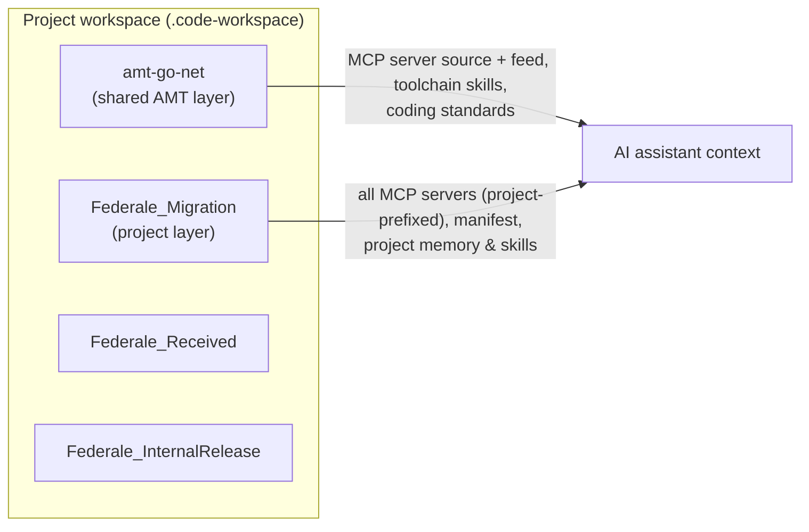

# 02 — Architecture: Two Layers

Related: [Overview](./01-overview-and-goals.md) · [Repositories & Workspace](./03-repositories-and-workspace.md) · [MCP Servers](./04-mcp-servers.md)

AMITY is split into **two layers that work together**. The split is the core idea:
the AMT toolchain knowledge stays shared and live across all projects, while each
project keeps its own identity, configuration, and findings.

## The two layers

| Layer | Lives in | Owns | Reused by |
|---|---|---|---|
| **Shared AMT layer** | `amt-go-net` (the toolchain repo itself, under `AMITY/`) | AMT/toolchain rules, the MCP servers + how to use/install them, how to debug the generator / transaction server, how to create an AMT_Products work item | **All** migration projects |
| **Project layer** | `<Project>_Migration` (e.g. `Federale_Migration`) | Project identity, active MCP servers/agents, ADO org+project, topology, project defect findings, "create a project issue", the workspace file | One project |

## What lives where

| Artifact | Shared AMT layer | Project layer |
|---|---|---|
| Steering (`AGENTS.md` + thin `copilot-instructions.md`) | toolchain rules | project identity, topology |
| Skills (`.github/skills/<name>/SKILL.md`) | debug generator, RCA, install MCP | create project issue, project workflows |
| Instructions (`.github/instructions/*.instructions.md`) | coding standards, tool resilience | memory rules, ADO defaults |
| Memory (`memory/`) | toolchain findings | project defect findings |
| Manifest (`amity.project.json`) | — | project config |
| MCP config (`.vscode/mcp.json`) | — (owns server **source** + `AMT_Mcp` feed/pipeline) | **all** servers, project-prefixed |

## How they compose

A project's VS Code multi-root workspace includes **both** the shared repo
(`amt-go-net`) and the project repo (`<Project>_Migration`). Because VS Code
aggregates instructions, skills, and `.vscode/mcp.json` across all workspace
folders, opening the workspace combines both layers automatically. See
[Repositories & Workspace](./03-repositories-and-workspace.md).

## Open design points

- **AGENTS.md composition/precedence** across the two layers (shared authoritative
  for toolchain; project overrides for identity). See
  [Authoring Standard](./08-authoring-standard.md) and
  [Status & Decisions](./09-status-decisions-roadmap.md).
- **Memory decay/review** runs per-project (proposed).
