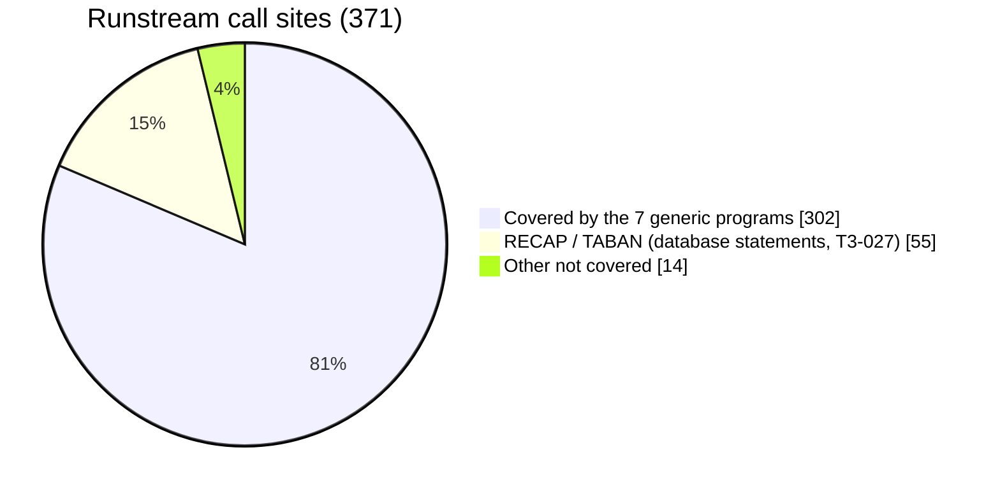
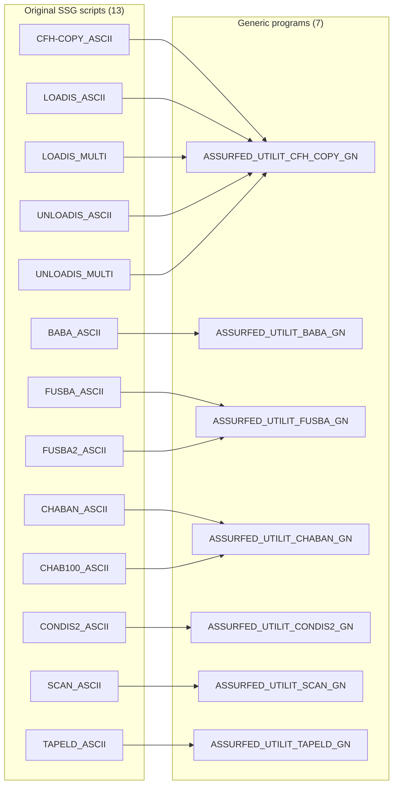
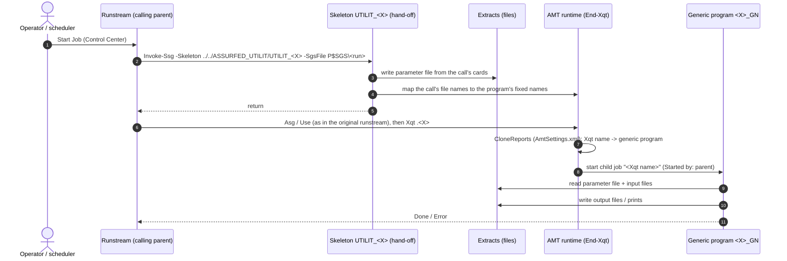
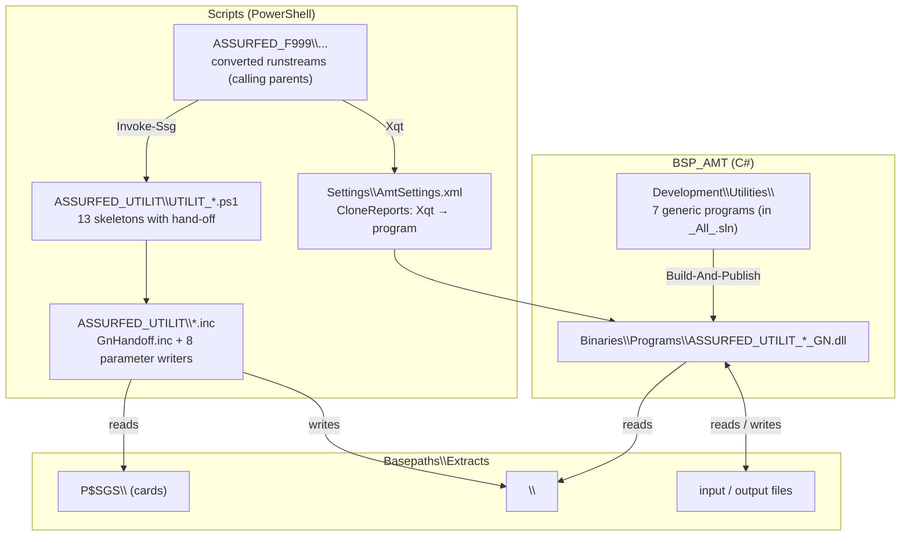
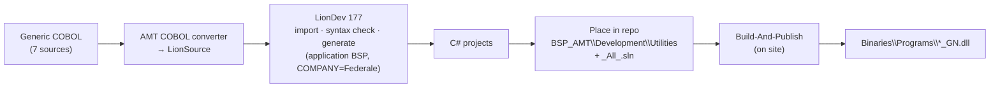
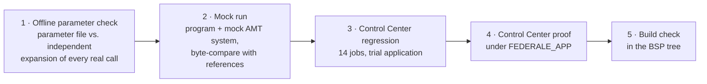
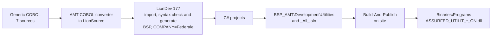
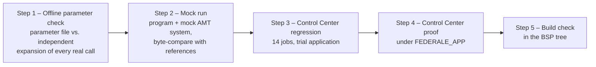

===== 1340
I'm in Ask mode here, so I can't create the file myself. The full Markdown is below: save it as e.g. `docs/SSG-Utilities-Program-Summary.md` and give it to copilot-researcher, or switch to Agent mode and I'll write it, and an HTML version, directly.

**Formatting options:**
- **VS Code preview:** the built-in Markdown preview shows the tables. Rendering the Mermaid diagrams there needs a Mermaid preview extension; I haven't checked whether one is installed on this VM.
- **Azure DevOps:** a `.md` file in the repo or the wiki renders Mermaid if it's written with `::: mermaid` blocks instead of `` ```mermaid ``. Worth checking against your project's wiki before sharing.
- **Styled HTML like the runbook:** I can produce a page in the same style as `SSG4-ControlCenter-Runbook.html`, with the diagrams rendered, if you switch to Agent mode.

I've marked with **[confirm]** the few points I couldn't verify from what we've built (one-line purposes, cards). Check those against each utility's `Conversion\Pipeline\Generic\<UTILITY>\spec.md` before sharing outside the team.

````markdown
# SSG Utilities — Generic Programs
## Program Summary (high-level specification)

| | |
|---|---|
| **Release** | `release20261022-rc.02` |
| **Application** | BSP (`BSP_AMT`, namespace `Federale.BSP.BusinessLogic`) |
| **Repository** | Federale_InternalRelease — branch `feature/federale/ssg4-generic-rc02` (PR into `main`) |
| **Audience** | Developers, testers, Federale |
| **Status** | Built and proven; awaiting R&D review (see §9) |

---

## 1. Purpose

On OS 2200, many batch runstreams called **SSG (Symbolic Stream Generator) skeletons** — small
"utility" generators such as `CFH-COPY`, `BABA` or `FUSBA`. For **each call**, SSG read the call's
parameter cards and **generated and compiled a new COBOL program**, which the runstream then ran
(`@XQT`).

After migration this would mean hundreds of generated programs (one per call). Instead, each
utility is now **one generic program, built once**, that reads the call's cards **at run time**
from a parameter file. Changing a call means changing its cards — nothing is rebuilt.

## 2. Scope

| | Count |
|---|---|
| Generic programs delivered | **7** |
| Original SSG scripts (skeletons) covered | **13** of 20 |
| Runstream call sites covered | **302** of 371 (81 %) |
| Converted runstreams that use them | **153** |



### 2.1 Scripts → programs



## 3. How a utility runs — the calling parent

The generic programs are **never started on their own**. A **calling parent** — a converted
runstream (`Scripts\ASSURFED_F999\...`) — reaches the step that used the utility.



What the user sees in Control Center run history: the **Xqt name** (e.g. `CFH_COPY`, `BABA`,
`TPF$` for TAPELD), *Started by* the runstream — not the program name.

## 4. Component overview



## 5. Program specifications

All programs: COBOL written once → converted to C# by AMT (LionDev 177, application BSP), batch
`AmtCobolProgram` jobs. Variable-length input records are read with a maximum of **4001 bytes**
(T3-040).

| Program | Started by Xqt | Purpose (summary) | Fixed files | Parameter file (record length) | Calls |
|---|---|---|---|---|---|
| **CFH_COPY_GN** | `CFH_COPY`, `LOADIS`, `UNLOADIS` | Copy a file record by record: whole record, or field moves (`FIELDIN`/`FIELDOUT`) plus constants (`FIXE`), optional start record. For LOADIS the hand-off also writes the indexed file's `.Index`; UNLOADIS reads it back sequentially. | `CFHIN` → `CFHOUT` | `CFHPARM` (250) | 62 |
| **BABA_GN** | `BABA` | **[confirm]** Select/split records of one input to two outputs by key rules from the cards. | `BABIN` → `BABOUT1`, `BABOUT2` | `BABPARM` (400) | 122 |
| **FUSBA_GN** | `FUSBA` | Merge two input files into one or two outputs; modes for FUSBA (copy / annul / field moves) and FUSBA2 (merge). | `FUSIN1`, `FUSIN2` → `FUSOUT1`, `FUSOUT2` | `FUSPARM` (80) | 36 |
| **CHABAN_GN** | `CHABAN` | Build records from data lines (cards) supplied with the step (CHAB100: 100-byte lines). | `CHAIN` (step data) → `CHAOUT` | `CHAPARM` (80) | 31 |
| **CONDIS2_GN** | `CONDIS2` | **[confirm]** Conditional copy/distribution of records from input to output by card-defined conditions. | `FILEIN` → `FILEOUT` | `CONPARM` (250) | 18 |
| **SCAN_GN** | `SCAN` | Scan an input file and print a report (record count limits from the cards). | `SCANIN` → print | `SCANPARM` (80) | 19 |
| **TAPELD_GN** | `TPF$` | Print a listing of a file with card-defined titles and field layout. | `TAPLIN` → print | `TAPPARM` (250) | 14 |

Per-utility detail (card syntax, byte-level behaviour, exceptions): `Conversion\Pipeline\Generic\<UTILITY>\spec.md`.

### 5.1 Hand-off (common to all)

| Step | Behaviour |
|---|---|
| Read cards | From the call's SGS file (raw card images; quoted values and continuation lines kept as SSG did). |
| Parameter file | Written to `Extracts\<qualifier>\<PARM>`, one resolved line per item, padded to the record length. |
| File names | The call's own logical names are mapped onto the program's fixed names (so one program serves every call). |
| Record sizes | Output record size set per call (task value `RECSIZE<name>`). |
| Mapping check | Stops (Abort) if the `CloneReports` entry for the Xqt is missing or points elsewhere. |

## 6. Build and delivery



| Repository location | Content |
|---|---|
| `BSP_AMT\Development\Utilities\<Project>` | C# project per program; COBOL in `Documentation\` (reading only); `README.md` |
| `BSP_AMT\Development\_All_.sln` | Solution folder *Utilities* with the 7 projects |
| `Scripts\ASSURFED_UTILIT` | 13 skeletons with the hand-off (replace the converted stubs); 9 `.inc` files |
| `Scripts\Settings\AmtSettings.xml` | `CloneReports` — 9 entries, Xqt name → program |

## 7. Testing



| Level | What | Result |
|---|---|---|
| Parameter check | Every real call's parameter file vs. the skeleton's own expansion | CFH-COPY 41 match (+1 known difference, 5 expansion defects); BABA 118/122; FUSBA 36/36; CHABAN 31/31; CONDIS2 18/18; SCAN 19/19; TAPELD 14/14 |
| CC regression (trial application) | 14 jobs covering all 7 programs, incl. abort cases (unsorted / duplicate keys) | All byte-identical / as expected |
| CC proof (FEDERALE_APP) | `CFH_COPY` started by a runstream step | Output byte-identical (jobs 1084 / 1085) |
| Build | 7 projects built in the BSP tree | 0 errors |

**Testers:** start the **runstream** (calling parent), not the `*_GN` job. Check the run history
for the child job named after the Xqt, then compare its outputs with the expected files.

## 8. Not covered (yet)

| Script | Call sites | Reason |
|---|---|---|
| RECAP | 28 | Embedded database statements (`RSA$INIT`) — T3-027 |
| TABAN_ASCII | 27 | Same as RECAP — T3-027 |
| LECTIS_ASCII | 1 | No generic program built yet |
| EXTEUR | 1 | Table from the old LINC repository — T3-037 |
| ARCHIFORMAT, ARCHISEPARE, ARCHIFUSION | 0 | Archive utilities with no caller in the drop — MT-047 |
| Others (FILE_SSG, unresolved) | 12 | To analyse |

## 9. Open points (R&D)

| ID | Point |
|---|---|
| MT-044 | `CloneReports` in `AmtSettings.xml` as the Xqt → program mapping place |
| MT-045 | `UTILIT_CHAB100_ASCII` missing in R&D's skeleton set |
| MT-046 | Replacing the converted skeleton stubs; settings `AppName`, `UseUnicode=False` (affects every job using the file) |
| MT-047 | Where are the archive runstreams? |
| — | Start Job lists the `*_GN` and `UTILIT_*` jobs; with *Activate All* they are startable by hand (they then fail: no parameter file) |

## 10. Glossary

| Term | Meaning |
|---|---|
| **SSG** | Symbolic Stream Generator — OS 2200 tool that generated source from a skeleton and cards |
| **Skeleton** | The SSG template for a utility (`UTILIT_<X>`); here a PowerShell script with the hand-off |
| **Cards** | The parameter lines of one call (`P$SGS\<run>`) |
| **Calling parent** | The converted runstream whose step calls the utility |
| **Hand-off** | Code at the top of a skeleton that turns the cards into the parameter file |
| **Generic program** | One compiled program per utility, driven by the parameter file |
| **Xqt** | The runstream statement that starts a program; mapped by `CloneReports` |
````

**Tell me how you want to continue:**
- **Fill in the [confirm] items** from each `spec.md`. That's read-only, so I can do it here.
- **Add the full 302-row call list as an appendix.** It's in `rc02-call-sites.csv`.
- **Create the `.md` and a styled HTML version in `docs/`.** This needs Agent mode.
===== 1344
Two things in Mermaid's label formatting cause what you're seeing:

1. **§7, "Unsupported markdown: list":** Mermaid treats a label that starts with a number followed by a dot, like `1. Offline …`, as a Markdown numbered list, and it can't draw lists inside a box. That's why every box shows the error instead of its text. I suspect that version of the file has `1.` where my draft had `1 ·`.
2. **§6, `_All_.sln` shows as *All*.sln:** the underscores around `All` are read as Markdown italics, so they disappear.

The fix is to avoid both patterns inside labels: "Step 1 –" instead of `1.`, and the HTML codes `#95;` for `_` and `#92;` for `\`.

**Replacement for §6:**

````markdown

````

**Replacement for §7:**

````markdown

````

The same two patterns can cause trouble in my other diagrams, mainly the scripts-to-programs map in §2.1 and the component overview in §4. Look for:
- **underscores in names** such as `ASSURFED_UTILIT_CFH_COPY_GN`, `UTILIT_*.ps1`, `P$SGS`. Two underscores in one label can turn the text between them italic. If a name looks wrong in the preview, replace `_` with `#95;`.
- **labels starting with a number and a dot.**

The sequence diagram in §3 is fine: message text there isn't parsed as Markdown.

To check the whole file at once, paste it into the chat or switch to Agent mode, and I'll fix every diagram in one pass.
===== 1362
The document isn't on this VM. Searching C: and E: found no `SSG-Utilit*.md`, so the copy you have open in Visual Studio is on your PC. Before deciding where it's built and kept, here's what each audience can actually reach:

| Audience | Can see |
|---|---|
| Developers (Federale and R&D) | Federale_InternalRelease and Federale_Release (through the weekly snapshot) |
| Testers | probably the same repos, or a wiki; to confirm |
| Us | SsgTrial on this VM (pipeline, runbook, tracker, call inventory) |

**Proposal:**

1. **Built in SsgTrial: one master copy, partly generated.** The master lives at `docs/SSG-Utilities-Program-Summary.md`, next to the runbook and tracker. The numbers that change between releases are written in by a small script from the data they come from, so they can't drift:
   - the coverage counts (302/371, 153 runstreams), from `sgs-calls.csv`;
   - the program table (Xqt names, fixed files, parameter files), from `utilities.json`;
   - the test results, from `regress-results.csv`;
   - the release, branch and commit.

   The explanations and diagrams stay hand-written. The Package/Place step would run the script, so every release gets an up-to-date summary.
2. **Shipped with the code.** A copy goes into the release branch as `BSP_AMT/Development/Utilities/PROGRAM-SUMMARY.md`, next to the `README.md`. It then travels with the code into Federale_InternalRelease and, through the snapshot, to Federale. The README stays short and links to it.
3. **Optional: a wiki page for testers**, only if they don't work from the repo. It would be a copy, refreshed per release.

**Points to check:**
- **Mermaid in Azure DevOps:** wiki pages need the `::: mermaid` syntax. I'm not sure the repository file preview renders Mermaid at all. If it doesn't, the shipped copy would need the diagrams as images, or we'd accept that the diagrams appear as code there.
- **Two copies:** the master in SsgTrial and the shipped copy are kept in step only by the release script. Nobody should edit the shipped copy by hand.

**Questions for you:**
1. Is the master in SsgTrial `docs/` (copied out at release) right, or should the master live in the release repo?
2. Ship it as `Utilities/PROGRAM-SUMMARY.md` alongside the README, or merge it into the README?
3. Can testers work from the repo, or do they need a wiki page?
4. Can you copy your current version from your PC to the VM (e.g. via 177Xfer, or paste it here)? Then I'd start from your edited version instead of my draft.
